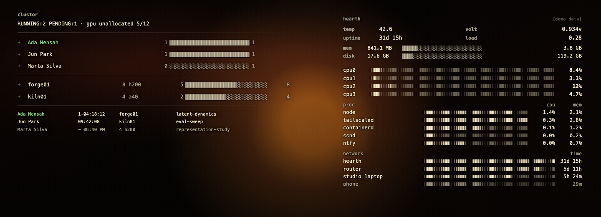

# Hearth

Hearth is a Raspberry Pi and compute-cluster dashboard for device presence, host telemetry, Slurm workloads, notifications, and remote-access status.

This public snapshot demonstrates the dashboard with fictional data. Live-capable source and its tests are included for inspection; helping readers operate their own live installation is outside the scope of this snapshot.



## Try the demo

Requirements: Node.js 20 or newer. There are no runtime packages to install.

```sh
git clone https://github.com/rrwwee/hearth-public.git
cd hearth-public
npm run demo
```

Open [http://127.0.0.1:4173](http://127.0.0.1:4173). Stop the server with Ctrl-C.

The demo binds to loopback, serves fictional in-process fixtures, disables credential and device-mutation endpoints, and does not invoke live adapters, notifications, network discovery, or operational logging. No private configuration is needed. Clear inherited `HEARTH_*` and `PORT` settings before running the default demo if your shell has been configured for a live installation.

## Architecture

The browser uses native JavaScript and CSS. A Node.js server owns policy, device-presence transitions, notifications, and protected actions. A Python agent supplies live host and scheduler observations; demo mode uses fixture functions instead of that agent.

The presence model distinguishes temporary offline status from a completed absence. Cluster queries carry independent validity, so a failed query does not invent an empty job list. Notification state retains pending deliveries across restarts, with possible duplicates when remote acceptance cannot be confirmed. Credential actions use explicit source and proxy trust.

See the [domain vocabulary](CONTEXT.md), [architecture decisions](docs/adr/), and [live implementation reference](docs/live-reference.md). The latter describes retained code and examples, rather than a supported deployment tutorial. [Bundle deployment notes](docs/deployment-bundles.md) explain the existing transport and recovery contract.

## Verification

The development toolchain uses the engine ranges in `package.json`, the pinned packages in `package-lock.json`, and Python 3.12 or newer as declared by `.python-version`. Install from the repository root:

```sh
npm ci
python3 -m venv .venv-lint
.venv-lint/bin/python -m pip install -r requirements-lint.txt
```

For an unpublished local candidate, run:

```sh
bash scripts/preflight.sh --mode local --systemd
npm run check:release
bash scripts/verify-deploy-systemd.sh
bash scripts/verify-vpn-systemd.sh
```

Local preflight verifies prerequisites but does not establish remote freshness. Once the public repository has an accessible `origin/main`, ordinary development uses `bash scripts/preflight.sh --systemd`; it must establish that the current remote base is included in the checkout. Do not add the private repository as a remote to resolve a missing public base. Historical review can use `--mode review --revision <commit>`.

The release check runs lint, syntax checks, JavaScript and Python tests, and repository-specific tree/history identifier audits. Tests use synthetic fixtures and temporary installations. The two systemd suites require a running Docker service, build disposable Linux containers, and exercise lifecycle behavior without a real VPN or cluster connection. Container builds fetch base images and packages; the running containers have network access disabled. Missing Docker or an unavailable check is a verification gap, not a pass.

The existing identifier audits do not replace a general credential scan or manual asset/metadata review. `audit:history` follows `HEAD`; before publication, review every intended ref and its full history, author metadata, and skipped binary/large material separately. See [verification policy](docs/agents/verification.md).

ESLint uses recommended correctness rules; Python uses Ruff `F,E9`; shell scripts use ShellCheck at info severity and above. Tools are pinned locally and missing tools fail the release gate. Syntax/lint discovery covers root source files, `demo`, `lib`, `public`, `pi/dashboard`, `scripts`, `test`, `docs/benchmarks`, and shell hooks in `.githooks`. Configuration, dependencies, generated state, symlinks, and scratch files are excluded by `scripts/source-files.mjs`.

Keep the frozen compatibility fixture in `test/fixtures/deployment_v1.py` and the synthetic fixture helpers. See [fixture guidance](test/fixtures/README.md). Optional benchmark tools remain under `docs/benchmarks/issue-21`; historical machine measurements are not distributed.

## Repository policy

The workflow runs `verify`, `systemd (deploy)`, and `systemd (vpn)` on every push and pull request. The [proposed main-branch rules](docs/main-ruleset.json) require an up-to-date pull request and all three GitHub Actions checks, with no standing bypass. A checked-in proposal does not establish that remote settings are active: those settings and public CI must be verified after an authorized upload.

Use [the public issue tracker](https://github.com/rrwwee/hearth-public/issues) for this snapshot. Retain the public repository's independent history when preparing later snapshots; never import private ancestry. Export preparation does not authorize publishing or deployment.

## License

Hearth is available under the [MIT License](LICENSE).
